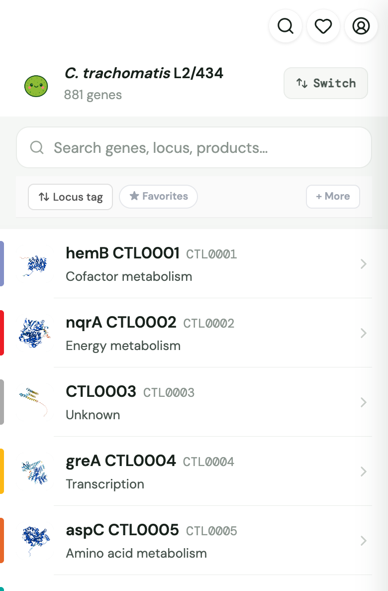
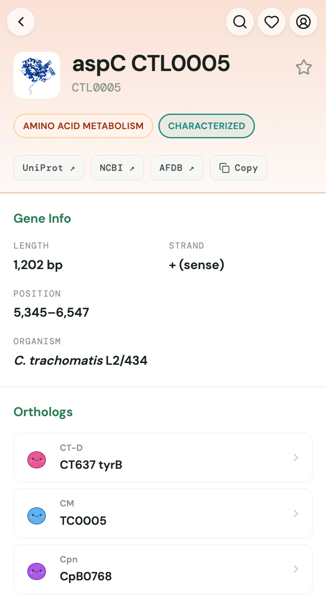
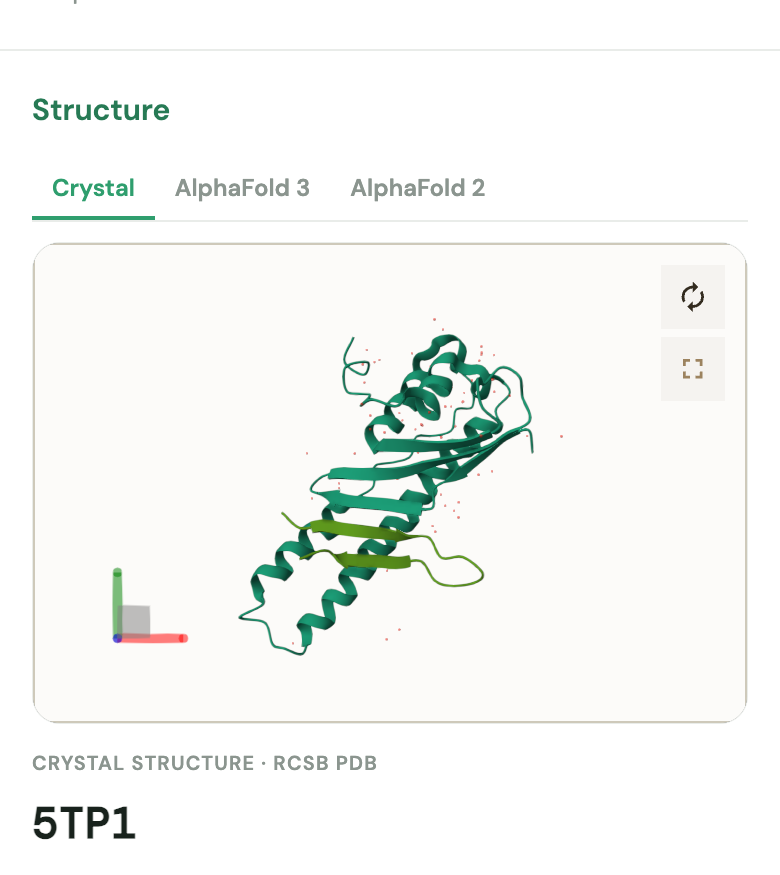

<p align="center">
  <a href="https://chlamatlas.org">
    
  </a>
</p>

<h1 align="center">ChlamAtlas</h1>

<p align="center">
  <strong>An integrated genomic, structural, and mutant resource for <em>Chlamydia</em> research</strong>
</p>

<p align="center">
  <a href="https://chlamatlas.org"></a>
  <a href="LICENSE"></a>
  <a href="LICENSE-DATA.md"></a>
</p>

<p align="center">
  
  &nbsp;
  
  &nbsp;
  
</p>

---

**ChlamAtlas** ([chlamatlas.org](https://chlamatlas.org)) brings together genome annotations, protein structures, expression data, and mutant collections for *Chlamydia*. Before ChlamAtlas, most of this information was scattered across supplemental files, spreadsheets, and lab notebooks. The site works on phones and desktops, and you can browse it without an account.

## Features

- **Genomes.** Browse every annotated gene in four reference genomes. Each gene has its own page with coordinates, product and functional category, subcellular localization, developmental expression profile, a genomic-context map, and links to NCBI, UniProt, and the AlphaFold Database.
- **Structures.** An interactive [Mol*](https://molstar.org) viewer shows experimental structures from the PDB alongside AlphaFold 2 and AlphaFold 3 predictions, with homology-inferred function annotations.
- **Orthologs.** Move between corresponding genes across strains in one click.
- **Protein interactions.** Curated host–pathogen and pathogen–pathogen interactions drawn from published screens and STRING.
- **Alignment tools.** Sequence and structure alignment across strains.
- **Mutants.** Searchable mutant collections (transposon, chemical, recombinant, and chimeric strains) with target genes, genotypes, and phenotype data.
- **Pipeline.** Tracks mutant generation, sequencing, and screening across the collaborating laboratories.
- **Surveillance.** Epidemiological trends in reported *Chlamydia* infections across regions.

### Genomes

| Organism | Strain |
|---|---|
| *Chlamydia trachomatis* | D/UW-3 |
| *Chlamydia trachomatis* | L2/434 |
| *Chlamydia muridarum* | Nigg |
| *Chlamydia pneumoniae* | TW-183 |

### Access

Genomic, proteomic, and structural data and published mutants are open to everyone. Unpublished mutants and in-progress pipeline records are visible only to signed-in members of the participating labs. These rules are enforced in the database with PostgreSQL row-level security, not just hidden in the interface.

## Architecture

ChlamAtlas is a static single-page application built in vanilla JavaScript. It is served by [Vercel](https://vercel.com) and backed by [Supabase](https://supabase.com) (PostgreSQL, authentication, and row-level security). Structure files and thumbnails are served directly from this repository.

```
web/          The web application (HTML, CSS, JavaScript)
supabase/     Database schema, migrations, row-level-security policies, edge functions
data/         Data import, curation, and processing scripts (genes, structures, orthologs, mutants, PPI)
AFmodels/     AlphaFold structure thumbnails used throughout the site
models/       AlphaFold Database (v4) models for C. trachomatis D/UW-3
structures/   Experimental (PDB) structures and AlphaFold 3 predictions
design/       Logos, strain icons, and other visual assets
```

## Citing ChlamAtlas

A manuscript describing ChlamAtlas is in preparation. Until it is published, please cite the website and this repository; see [`CITATION.cff`](CITATION.cff), or use **"Cite this repository"** in the GitHub sidebar.

## License

The source code is released under the [MIT License](LICENSE). Data curated by ChlamAtlas is released under [CC BY 4.0](LICENSE-DATA.md). Third-party data and bundled software keep their original licenses; see [`LICENSE-DATA.md`](LICENSE-DATA.md) for details.

## Contact

ChlamAtlas is developed and maintained by the [Hybiske Lab](https://hybiskelab.org) at the University of Washington, together with the Rockey Lab (Oregon State University) and the Hefty Lab (Kansas State University).

Questions, corrections, and data contributions are welcome: Kevin Hybiske · khybiske@uw.edu
